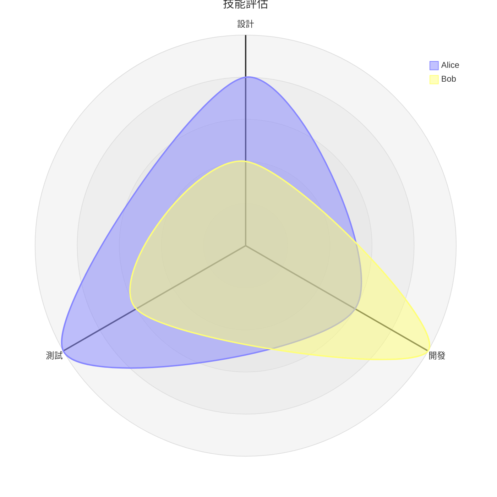
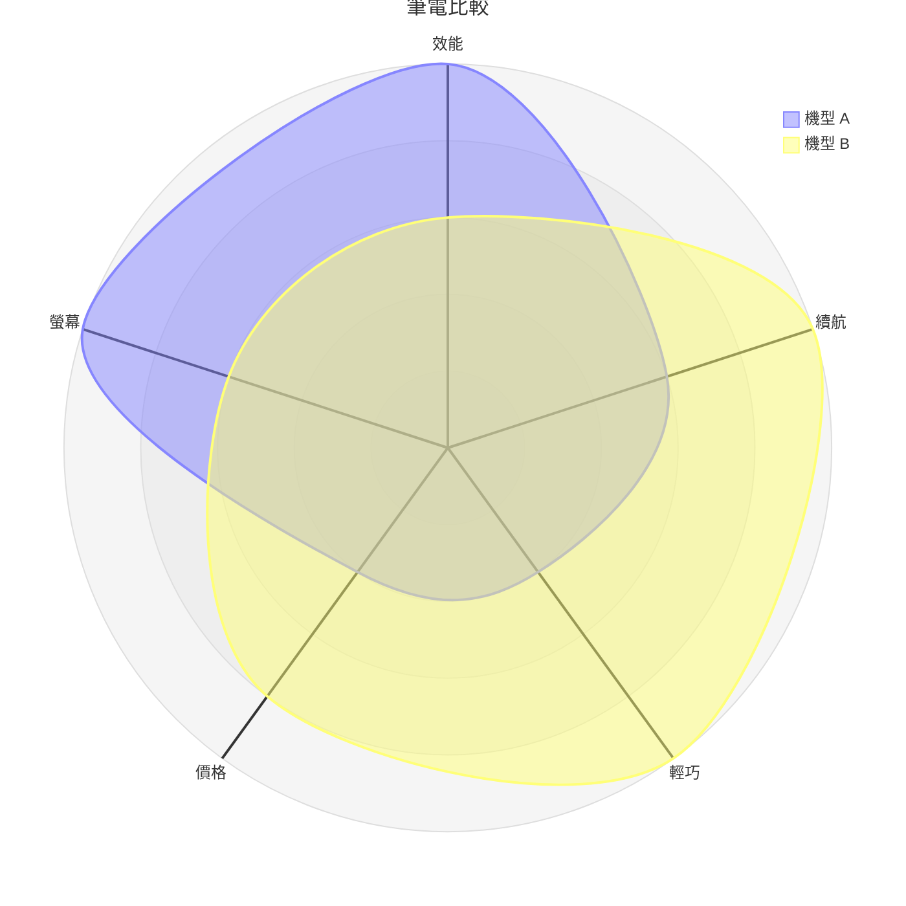

# Radar Chart (radar-beta)

Multi-dimension scores on a shared scale — skill profiles, product comparisons, evaluation rubrics.

## When to use

**Best for**:
- Comparing 1–4 items across 3–8 dimensions on the same scale
- Skill / capability profiles

**User query 關鍵字**: radar / spider chart / skill profile / 雷達圖 / 能力評估 / レーダーチャート

**Not for**: time series (use `data-viz/xychart.md`), 2-axis positioning (use `data-viz/quadrant.md`), dimensions with different units.

## Canonical syntax

- `axis id["Label"], ...` declares the dimensions in order.
- `curve id["Label"]{v1, v2, ...}` gives one value per axis, in axis order.
- Optional: `max N`, `min N`, `ticks N`, `graticule polygon`, `showLegend true`.

## Obsidian 1.15 compatibility

- **Status**: ✅ renders in Pele 1.13.0 (validator-checked, not checked on device)
- **Known quirks**: axis and curve IDs are ASCII identifiers; CJK goes in the bracket label

## Worked examples

### Example 1: Product comparison

## Error prevention

| ❌ Wrong | ✅ Right | Reason |
|---|---|---|
| Value count ≠ axis count | One value per axis | Values map to axes by position |
| `curve x[1, 2, 3]` | `curve x{1, 2, 3}` | Values use braces |

See also [obsidian-common-quirks.md](../obsidian-common-quirks.md) for universal rules.
