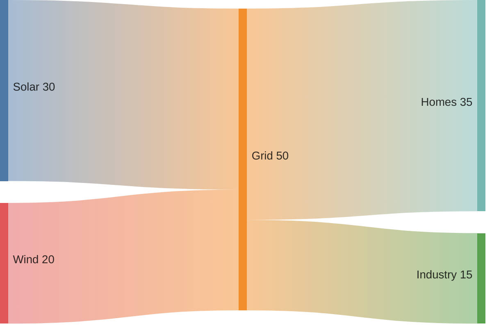

# Sankey Diagram (sankey-beta)

Flow quantities between stages — energy flows, budget allocation, user funnels.

## When to use

**Best for**:
- Showing how a quantity splits and merges across stages
- Funnels and source → destination allocation

**User query 關鍵字**: sankey / flow volume / funnel / allocation / 桑基圖 / 流量分配 / サンキー

**Not for**: process steps without quantities (use `flow/flowchart.md`), simple proportions (use `data-viz/pie.md`).

## Canonical syntax



- One `source,target,value` row per flow, CSV style; no indentation needed.
- Names may be CJK. A name containing a comma must be wrapped in double quotes: `"A,1",B,10`.

## Obsidian 1.15 compatibility

- **Status**: ✅ renders in Pele 1.13.0 (validator-checked, not checked on device)
- **Known quirks**: a node's outflow larger than its inflow still renders; check totals yourself

## Worked examples

### Example 1: Website traffic funnel

```mermaid
sankey-beta
搜尋,首頁,600
社群,首頁,400
首頁,商品頁,700
首頁,離開,300
商品頁,結帳,250
商品頁,離開,450
```

## Error prevention

| ❌ Wrong | ✅ Right | Reason |
|---|---|---|
| `A -> B : 10` | `A,B,10` | Rows are CSV |
| `A,1,B,10` (comma in name) | `"A,1",B,10` | Quote names that contain commas |

See also [obsidian-common-quirks.md](../obsidian-common-quirks.md) for universal rules.
