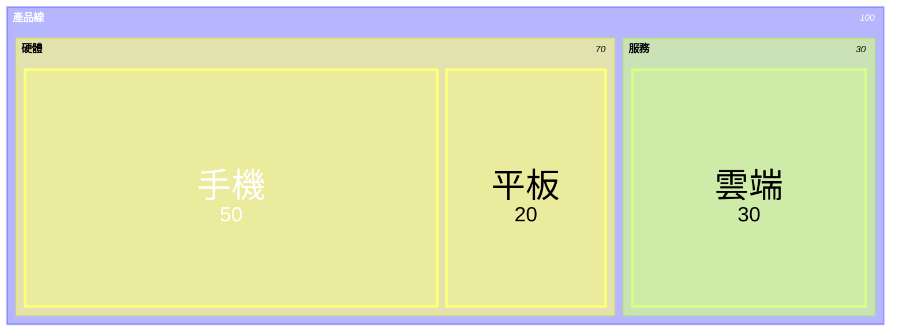
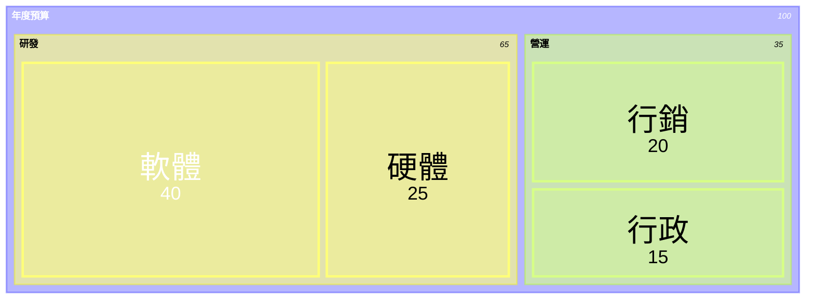

# Treemap (treemap-beta)

Hierarchical part-of-whole — budget by department, revenue by product line, disk usage.

## When to use

**Best for**:
- Nested proportions (category → sub-category → value)
- Comparing many leaf sizes at once

**User query 關鍵字**: treemap / nested proportion / budget breakdown / 樹狀圖 / 矩形樹圖 / ツリーマップ

**Not for**: flat proportions with ≤6 parts (use `data-viz/pie.md`), trends over time (use `data-viz/xychart.md`), file trees without values (use `structural/treeview.md`).

## Canonical syntax

- Every node name is quoted.
- Indentation sets the hierarchy; leaves carry `: value`. Parent totals are summed automatically.

## Obsidian 1.15 compatibility

- **Status**: ✅ renders in Pele 1.13.0 (validator-checked, not checked on device)
- **Known quirks**: indentation must be consistent; a leaf without `: value` is silently dropped

## Worked examples

### Example 1: Annual budget (NT$ M)

## Error prevention

| ❌ Wrong | ✅ Right | Reason |
|---|---|---|
| `硬體` (unquoted name) | `"硬體"` | Node names are strings |
| Mixed tab / space indentation | One indentation style | Hierarchy is read from indentation |
| `"A"` leaf with no value | `"A": 10` | Leaves without a value are dropped |

See also [obsidian-common-quirks.md](../obsidian-common-quirks.md) for universal rules.
