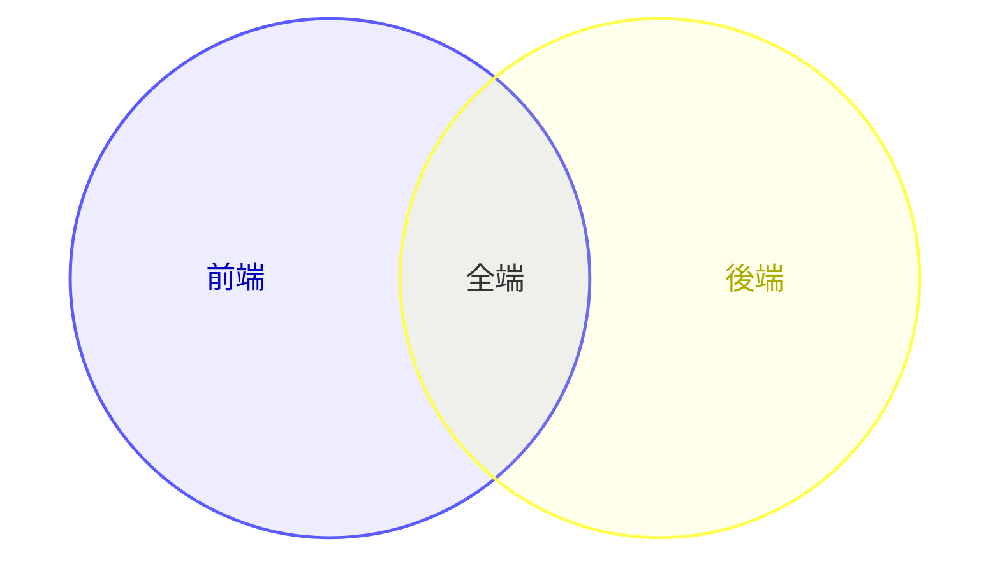
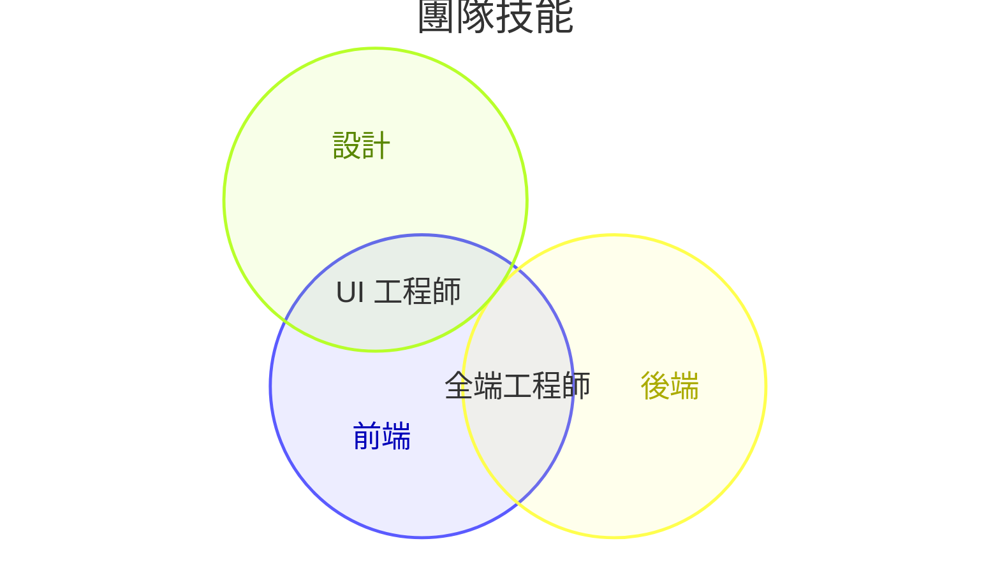

# Venn Diagram (venn-beta)

Overlap between two or three sets — shared skills, feature overlap, audience segments.

## When to use

**Best for**:
- Showing what two or three groups have in common
- Skill / feature / audience overlap

**User query 關鍵字**: venn / overlap / intersection / 交集 / 重疊 / 文氏圖 / ベン図

**Not for**: exact proportions (use `data-viz/pie.md`), more than three sets (use a table), hierarchies (use `data-viz/treemap.md`).

## Canonical syntax

- `set ID["Label"]` declares a set; the ID is ASCII, the label may be CJK.
- `union ID,ID["Label"]` labels the overlap of the listed sets.
- Optional `title` line (unquoted).

## Obsidian 1.15 compatibility

- **Status**: ✅ renders in Pele 1.13.0 (validator-checked, not checked on device)
- **Colours**: set colours follow `themeVariables.venn1`–`venn8`; other theme settings are ignored ([engine limits](../obsidian-compatibility.md))
- **Known quirks**: set IDs must be ASCII; put CJK in the bracket label

## Worked examples

### Example 1: Three-set skill overlap

## Error prevention

| ❌ Wrong | ✅ Right | Reason |
|---|---|---|
| `set 前端` | `set FE["前端"]` | IDs are identifiers — keep them ASCII |
| `union A B` | `union A,B["Label"]` | Sets are comma-separated |

See also [obsidian-common-quirks.md](../obsidian-common-quirks.md) for universal rules.
