# XY Chart (xychart-beta)

Bar and line charts for categorical / numerical data — revenue trends, signup curves, multi-series comparisons.

## When to use

**Best for**:
- Discrete numeric data across categories (monthly revenue / quarterly counts / per-product sales)
- Trend visualization over time (monthly sign-ups / weekly DAU / daily metrics)
- Multi-series comparison (Product A vs B vs C over same x-axis)
- Any quantitative visualization where exact numbers matter

**User query 關鍵字**:
- Bar: `長條圖` / `bar chart` / `column chart` / `條形圖` / `histogram`
- Line: `折線圖` / `line chart` / `trend` / `走勢` / `時間序列` / `time series`
- Multi-series: `比較` / `comparison` / `A vs B over time` / `multi-line`

**Not for**: proportion of whole (use `data-viz/pie.md`), 2×2 positioning (use `data-viz/quadrant.md`), qualitative comparisons (use `flow/comparison.md`).

## Canonical syntax — bar mode

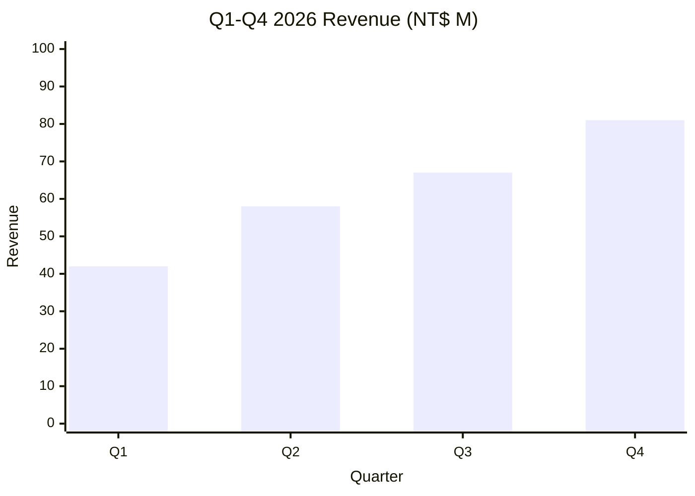

**Minimum required**:
- `xychart-beta` directive on line 1
- At least one data series (`bar` or `line`)
- x-axis category labels (all categorical labels **must be quoted** — see § Style rule below)

**Optional but recommended**:
- `title` for context
- `y-axis` label + range
- Multiple data series

### Style rule — axis declarations

Two conventions enforced across all xychart examples:

**Rule 1: both axes always have a name label**

```
✅ x-axis "Quarter" ["Q1", "Q2", "Q3", "Q4"]
✅ y-axis "Revenue (NT$ M)" 0 --> 100

❌ x-axis ["Q1", "Q2", "Q3", "Q4"]              ← missing x-axis label
❌ y-axis 0 --> 100                              ← missing y-axis label
```

Axis names make charts self-describing without reader having to infer from data context. Cost: ~15 characters per axis; benefit: unambiguous meaning.

**Rule 2: all categorical (non-continuous) axis elements wrapped in `""`**

```
✅ x-axis "Quarter" ["Q1", "Q2", "Q3", "Q4"]
✅ x-axis "月份" ["1月", "2月", "3月"]
✅ x-axis "Product" ["Product A", "Product B"]

❌ x-axis "Quarter" [Q1, Q2, Q3, Q4]            ← unquoted categorical elements
❌ x-axis "月份" [1月, 2月, 3月]
```

Numeric axis ranges (`y-axis "Revenue" 0 --> 100`) are continuous — no quoting.

**Combined canonical form**:

```
x-axis "LabelName" ["Cat1", "Cat2", "Cat3"]
y-axis "LabelName" MIN --> MAX
```

**Why both rules**: eliminate per-case judgment. Any xychart produced by this skill is self-describing (has axis labels) and handles edge cases consistently (CJK / special chars / reserved words via uniform quoting).

## Canonical syntax — line mode (use NAMED-LINE form)

**Named-line syntax** — each named series gets a legend entry in Obsidian 1.15:

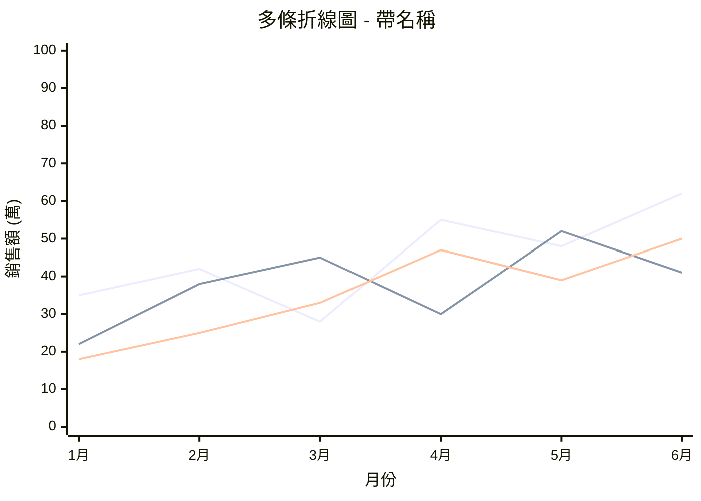

**Default pattern for line charts**: use `line "series name" [values]` — the named form renders correctly in Obsidian's native viewer. Each series shown with distinct color + legend.

### Bare `line [values]` (without name)

Renders in Obsidian 1.15, but an unnamed series gets no legend entry. Prefer `line "name" [values]` even for single-series charts.

### Point labels on a line

Add a quoted text after any value to label that point; points without text stay plain:

```mermaid
xychart-beta
    title "市場相對走勢（虛構）"
    x-axis "觀察日" ["D1", "D2", "D3", "D4"]
    y-axis "起點為100" 80 --> 110
    line "台股" [100, 96, 90 "事件日", 93 "台股93"]
    line "美股" [100, 99, 95, 97 "美股97"]
```

To show every value, write it as text after each point (`10 "10"`). Text after a **bar** value parses but is not displayed — use `showDataLabel` for bars.

### Bar value labels

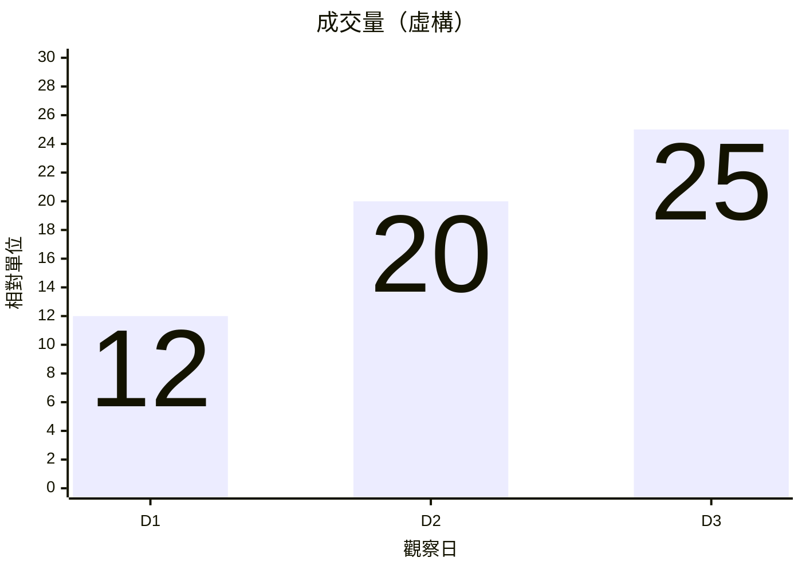

Values are drawn outside the bar whatever `showDataLabelOutsideBar` says.

### Candlestick / OHLC — not supported

There is no candlestick command (only `line` and `bar`). Embed an image of a candlestick chart made elsewhere, or plot closing prices with `line` and say it is not a candlestick chart.

## Configuration options

### Orientation (horizontal bars)

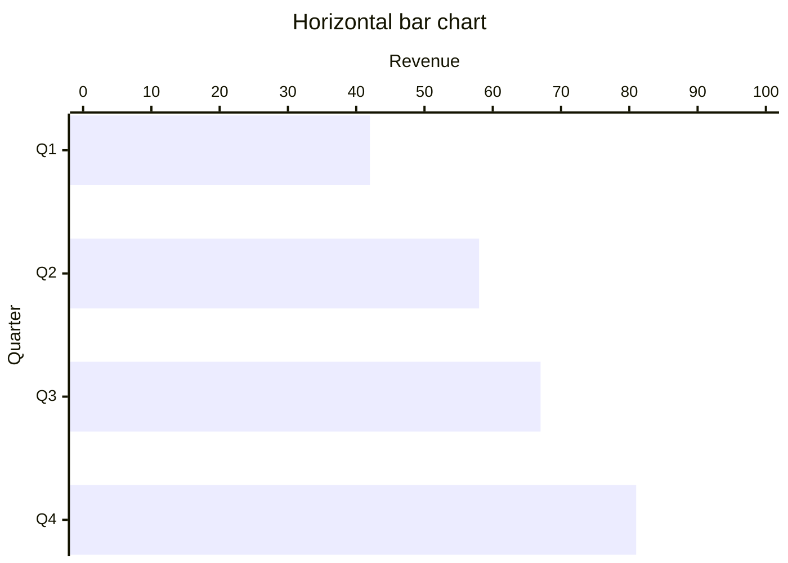

`xychart-beta horizontal` flips rendering direction only — **axis declarations stay the same as vertical** (categories on `x-axis`, numeric values on `y-axis`). The renderer draws horizontal bars extending along the value axis.

**Key point**: don't swap x-axis and y-axis when switching to horizontal. The `horizontal` keyword handles the reorientation; your declarations remain categorical=x, numeric=y.

### Multiple series (side-by-side bars)

```mermaid
xychart-beta
    title "Revenue vs Profit (Q1-Q4)"
    x-axis "Quarter" ["Q1", "Q2", "Q3", "Q4"]
    y-axis "NT$ M" 0 --> 100
    bar [42, 58, 67, 81]
    bar [12, 18, 22, 28]
```

Two `bar [...]` lines render as paired bars per category. Add names for legend labels: `bar "Revenue" [...]`.

### Multi-line (named)

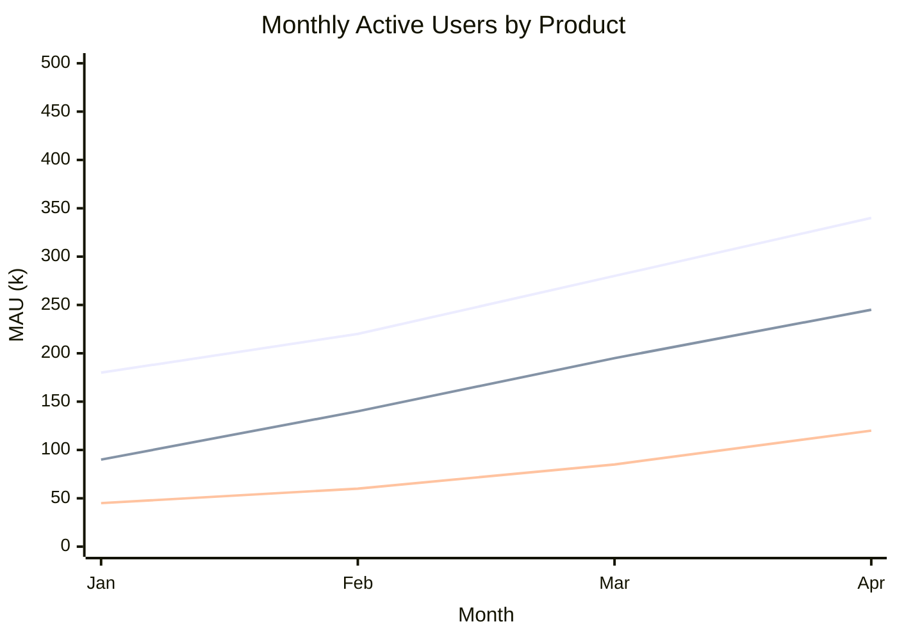

Each named line renders as a distinct colored line with legend entry.

### Bar + line combined

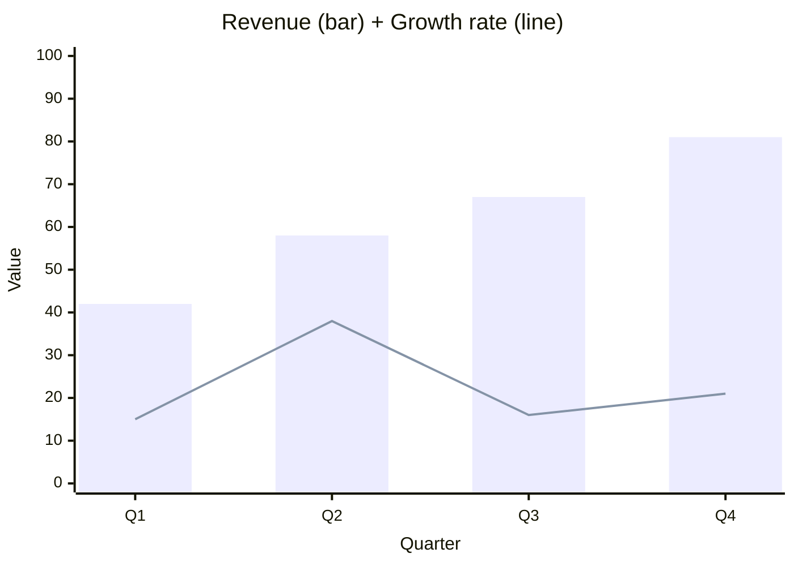

Mixes bar and line on same chart when both quantities share the y-axis range.

### Y-axis range

```text
y-axis "Label" MIN --> MAX
```

If omitted, Mermaid auto-scales. Explicit ranges force consistent scale across multiple charts (e.g., year-over-year comparisons).

## Obsidian 1.15 compatibility

- **Status**: ✅ Full support — bar, named line, bare line, point labels, bar value labels
- **Known quirks**:
  - Series colours come only from `themeVariables.xyChart.plotColorPalette` (series order); other theme settings are ignored
  - Dense x-axis categories may be thinned — not every label is guaranteed to show
  - Very dense multi-series (>4 lines) can get visually crowded
  - `xychart` (without `-beta`) also renders; keep `-beta` for other renderers

## Worked examples

### Example 1: Monthly revenue bar chart

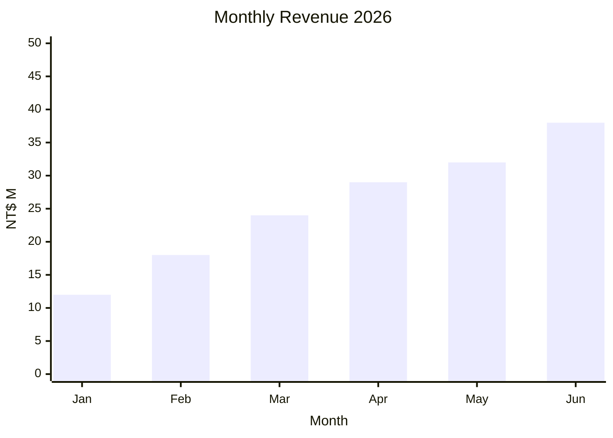

### Example 2: Single-series line chart (named)

```mermaid
xychart-beta
    title "Monthly Sign-ups"
    x-axis "Month" ["Jan", "Feb", "Mar", "Apr", "May", "Jun"]
    y-axis "Users" 0 --> 1000
    line "Sign-ups" [120, 280, 450, 620, 810, 950]
```

### Example 3: Multi-line comparison


### Example 4: Horizontal bar comparing quarters

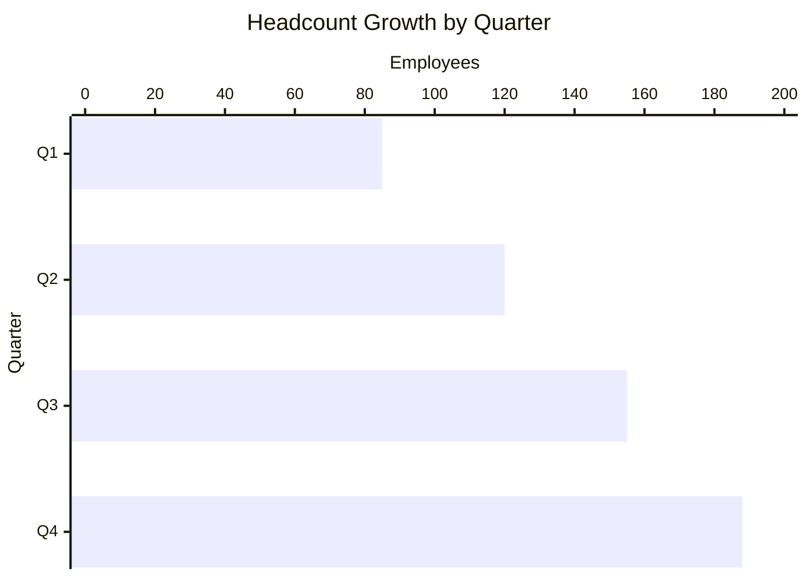

Note: `horizontal` flips rendering orientation only; axis declarations keep the same structure as vertical mode (categorical labels on x-axis, numeric scale on y-axis).

### Example 5: Two-series bar comparison

```mermaid
xychart-beta
    title "Product A vs Product B Sales"
    x-axis "Quarter" ["Q1", "Q2", "Q3", "Q4"]
    y-axis "Units sold" 0 --> 500
    bar "Product A" [250, 310, 380, 420]
    bar "Product B" [180, 230, 290, 340]
```

### Example 6: Mixed bar + line

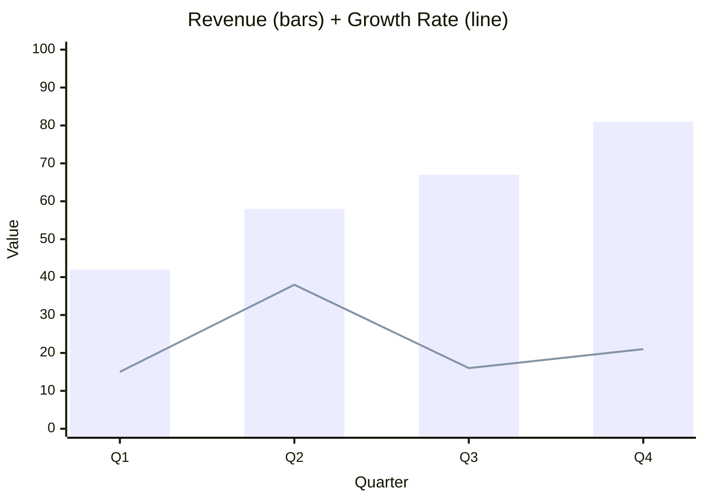

## Error prevention

| ❌ Wrong | ✅ Right | Reason |
|---|---|---|
| `xychart` (no `-beta`) | `xychart-beta` | Both render in Obsidian 1.15; `-beta` also works in older renderers |
| `line [1,2,3]` without name | `line "SeriesName" [1,2,3]` | Unnamed series get no legend entry |
| `candlestick [...]` | `line "收盤" [...]` or an embedded image | No candlestick command — parse error |
| x-axis array length ≠ data array length | Match lengths exactly: `[Q1,Q2,Q3]` paired with `[a,b,c]` | Mismatch causes render error or wrong labels |
| `y-axis "Label" 0 -> 100` (wrong arrow) | `y-axis "Label" 0 --> 100` | Must use `-->` double-hyphen |
| Missing quotes on title with spaces | `title "Has Spaces"` | Strings with spaces need quotes |
| Relying on `showDataLabelOutsideBar: false` | Expect labels outside the bar | Pele ignores the setting |
| Text after a bar value `bar [10 "事件"]` | `showDataLabel: true` | Bar point text is not displayed |
| Swapping x-axis / y-axis for `horizontal` mode | Keep categorical on x-axis, numeric on y-axis; let `horizontal` flip rendering | `horizontal` reorients visuals; axis declarations stay the same as vertical |
| Unquoted categorical axis elements `[Q1, Q2]` | Quote all categorical labels `["Q1", "Q2"]` | Statutory rule per § Style rule Rule 2 — consistent pattern for non-continuous axes |
| Axis without name label `x-axis ["Q1", "Q2"]` | `x-axis "Quarter" ["Q1", "Q2"]` | Statutory rule per § Style rule Rule 1 — charts must be self-describing |

### Pre-save validation

- [ ] `xychart-beta` declared on line 1 (with `-beta` suffix)
- [ ] x-axis array length matches each data series array length
- [ ] **Both axes have name labels** — `x-axis "Quarter" [...]` and `y-axis "Revenue" ...` (see § Style rule Rule 1)
- [ ] **All categorical axis labels quoted** — `["Q1", "Q2"]` not `[Q1, Q2]` (see § Style rule Rule 2)
- [ ] Line charts use named-line syntax: `line "name" [values]`
- [ ] Title quoted if contains spaces
- [ ] y-axis uses `-->` double-hyphen arrow syntax
- [ ] No candlestick / OHLC requested of Mermaid (not supported)
- [ ] For horizontal mode: axis declarations stay categorical=x, numeric=y (don't swap)

See also [obsidian-common-quirks.md](../obsidian-common-quirks.md) and [obsidian-compatibility.md](../obsidian-compatibility.md).
