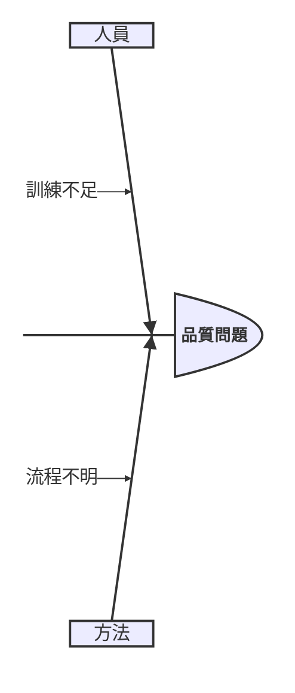
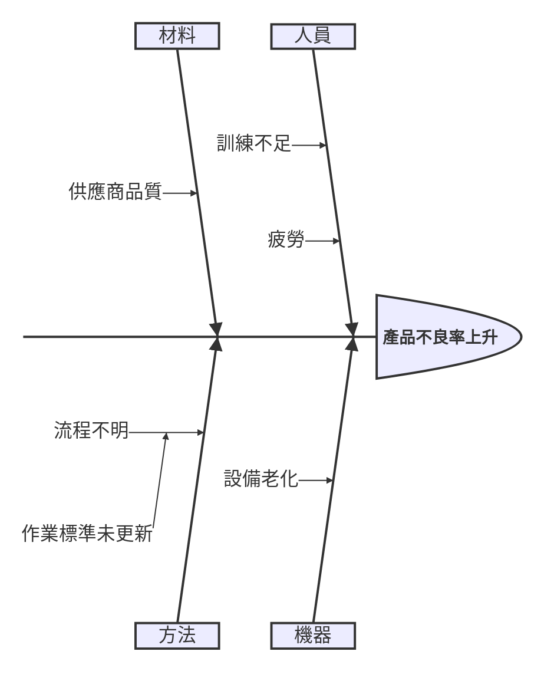

# Ishikawa / Fishbone (ishikawa-beta)

Root-cause analysis — causes grouped by category leading to one effect.

## When to use

**Best for**:
- Root-cause analysis (6M: man / machine / material / method / measurement / environment)
- Post-incident reviews

**User query 關鍵字**: fishbone / ishikawa / root cause / cause and effect / 魚骨圖 / 要因分析 / 特性要因図

**Not for**: sequences of events (use `flow/flowchart.md` or `time/timeline.md`), free-form topic trees (use `flow/mindmap.md`).

## Canonical syntax

- The first line after `ishikawa-beta` is the effect (the fish head).
- Each following line at that indent is a category; causes are indented under it, and sub-causes one level deeper.
- Text is unquoted; CJK works.

## Obsidian 1.15 compatibility

- **Status**: ✅ renders in Pele 1.13.0 (validator-checked, not checked on device)
- **Known quirks**: keep to 4–6 categories with ≤4 causes each for readability

## Worked examples

### Example 1: Product defect (4M)

## Error prevention

| ❌ Wrong | ✅ Right | Reason |
|---|---|---|
| Categories before the effect line | Effect line first | The first line is the effect |
| Causes at the category indent | Indent causes under their category | Indentation sets the branch |

See also [obsidian-common-quirks.md](../obsidian-common-quirks.md) for universal rules.
