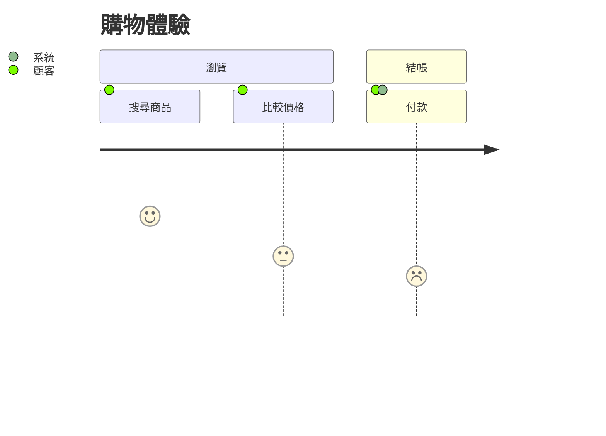
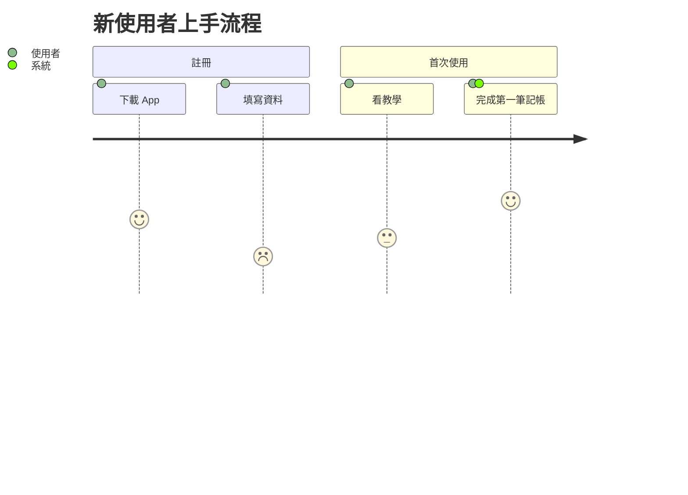

# User Journey (journey)

Steps a user takes, with a satisfaction score per step — customer journeys, onboarding experience.

## When to use

**Best for**:
- Customer / user experience maps with pain points
- Comparing how different actors feel at each step

**User query 關鍵字**: user journey / customer journey / experience map / 使用者旅程 / 顧客旅程 / カスタマージャーニー

**Not for**: system interactions (use `flow/sequence.md`), decision logic (use `flow/flowchart.md`).

## Canonical syntax

- `section Name` groups steps.
- Each step is `Task: score: actor1, actor2`; score is 1 (bad) to 5 (good).
- Title, section and task text are unquoted free text; CJK works.

## Obsidian 1.15 compatibility

- **Status**: ✅ renders in Pele 1.13.0 (validator-checked, not checked on device)
- **Known quirks**: a colon inside task text is read as a field separator — rephrase it

## Worked examples

### Example 1: App onboarding

## Error prevention

| ❌ Wrong | ✅ Right | Reason |
|---|---|---|
| `付款 - 2 - 顧客` | `付款: 2: 顧客` | Fields are colon-separated |
| Score `0` or `10` | 1–5 | The scale is 1–5 |

See also [obsidian-common-quirks.md](../obsidian-common-quirks.md) for universal rules.
