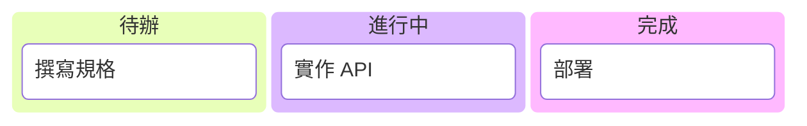
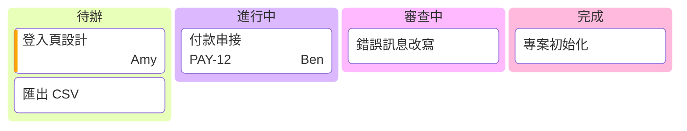

# Kanban Board (kanban)

Work items grouped by status column — task boards, sprint snapshots.

## When to use

**Best for**:
- A snapshot of tasks by status (To do / Doing / Done)
- Sprint or project boards with owners and priorities

**User query 關鍵字**: kanban / task board / sprint board / 看板 / 任務板 / カンバン

**Not for**: schedules with dates (use `time/gantt.md`), process logic (use `flow/flowchart.md`).

## Canonical syntax

- A column is `id[Title]` at the first indent; its cards are indented under it as `id[Text]`.
- Card metadata: `t1[撰寫規格]@{ ticket: MC-1, assigned: 'kouko', priority: 'High' }`.

## Obsidian 1.15 compatibility

- **Status**: ✅ renders in Pele 1.13.0 (validator-checked, not checked on device)
- **Known quirks**: every column and card needs a unique ID (CJK IDs also render; short ASCII IDs keep metadata lines readable)

## Worked examples

### Example 1: Sprint board with metadata

## Error prevention

| ❌ Wrong | ✅ Right | Reason |
|---|---|---|
| Card at the same indent as its column | Indent cards under the column | Indentation assigns cards to columns |
| Reused IDs across cards | Unique IDs | IDs identify cards |

See also [obsidian-common-quirks.md](../obsidian-common-quirks.md) for universal rules.
