# State Diagram

System states, status transitions, lifecycle stages — finite state machines.

## When to use

**Best for**:
- Finite state machines (FSM) with explicit states and transitions
- Lifecycle stages (order: created → paid → shipped → delivered)
- UI states (loading / error / success / idle)
- Protocol states (connecting / connected / disconnected / reconnecting)
- Workflow statuses (draft / review / approved / published)

**User query 關鍵字**: state diagram / FSM / state machine / lifecycle / status / 狀態圖 / 狀態機 / 狀態轉換 / transition

**Not for**: process flows without discrete states (use `flow/flowchart.md`), message timing between actors (use `flow/sequence.md`), hierarchy (use `flow/mindmap.md`).

## Canonical syntax

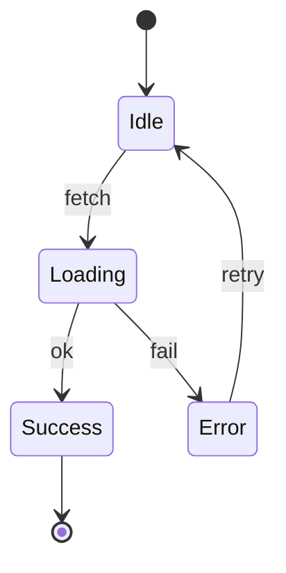

**Prefer `stateDiagram-v2`** for portability to other renderers. In Obsidian 1.15 the older `stateDiagram` header also renders.

## Configuration options

### Basic transitions

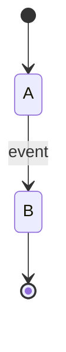

### Composite (nested) states

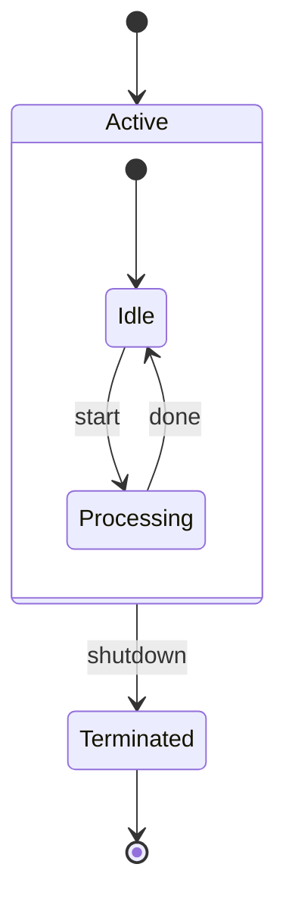

### Choice (decision) points

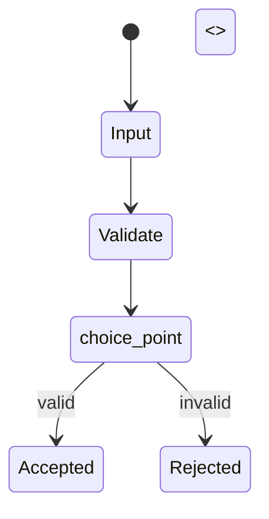

### Fork / join (parallel states)

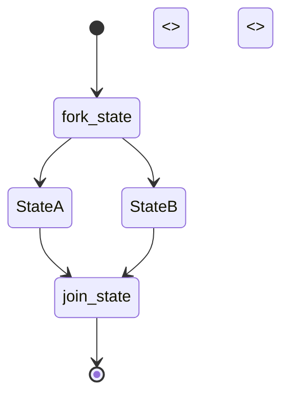

### Notes

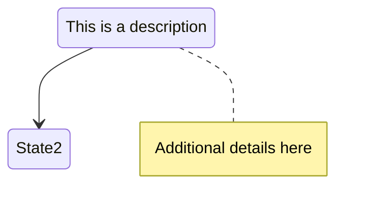

### Direction

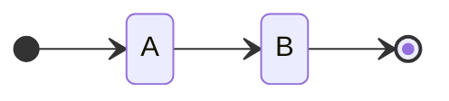

`direction` takes `LR`, `TB`, `BT` or `RL`. Write one transition per line — chained `A --> B --> C` is a parse error.

## Obsidian 1.15 compatibility

- **Status**: ✅ Full support
- **Known quirks**:
  - `stateDiagram` (v1 header) and `stateDiagram-v2` both render; prefer v2 for other renderers
  - Chained transitions (`A --> B --> C`) and `#` end-of-line comments are parse errors
  - Choice / fork / join syntax must be precise; typos cause render failures
  - Composite states nested >2 levels deep can overflow preview pane
- **Workaround**: none needed

## Quote rule for state diagrams

State diagrams, like sequence diagrams, treat text after `:` as free-form description. Adding `"..."` around transition labels or state descriptions makes the quotes render literally.

**Do NOT quote**:
- State description: `State1 : description` (NOT `State1 : "description"`)
- Transition label: `A --> B: label` (NOT `A --> B: "label"`)

**State IDs must remain unquoted identifiers** (`Idle`, `Loading`, etc.) — these are not display strings, they are references. If you need a multi-word state, use underscore (`Virus_scan`) or camelCase (`VirusScan`).

**For CJK / special characters in state**: CJK renders unquoted in descriptions and transition labels in Obsidian 1.15 (Pele 1.13.0 render check). There is no quoting escape (quotes render literally); if a label fails `scripts/validate.sh`, rephrase it rather than wrapping in quotes. Keep state **IDs** ASCII for portability and put CJK in the description (`Scanning : 病毒掃描`) — Pele accepts CJK IDs, but other renderers may not.

## Worked examples

### Example 1: Simple UI state

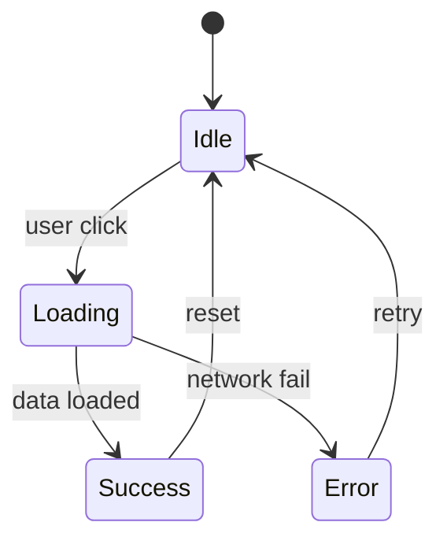

### Example 2: Order lifecycle

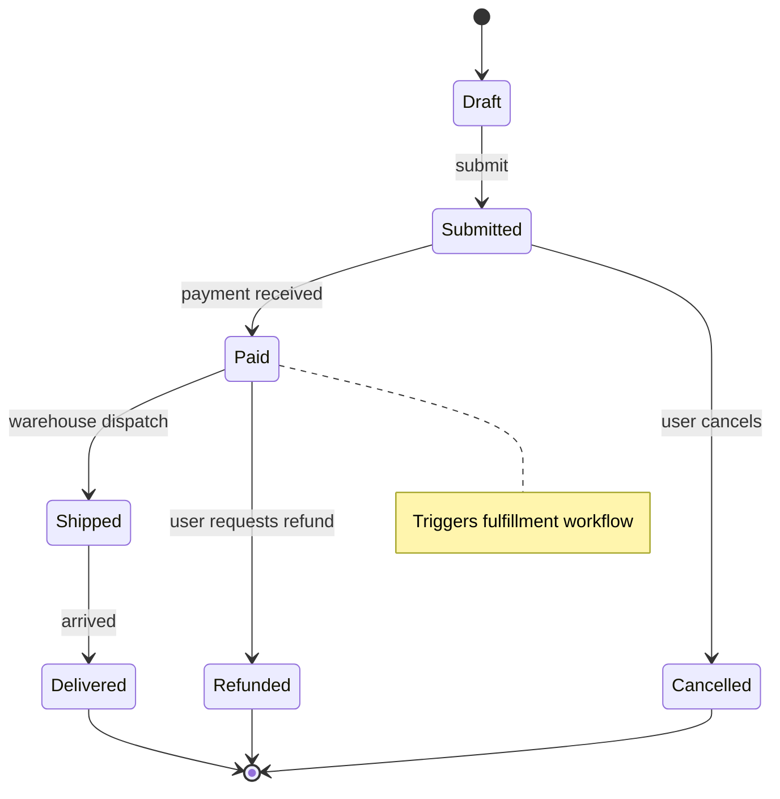

### Example 3: Composite state (nested — connection lifecycle)

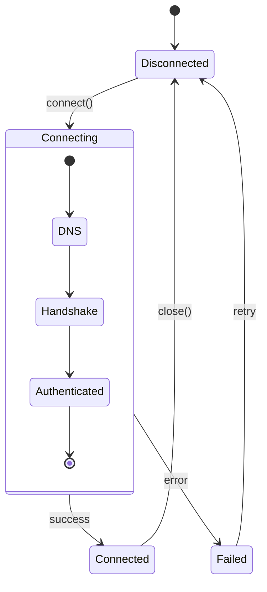

### Example 4: Parallel states (document processing pipeline)

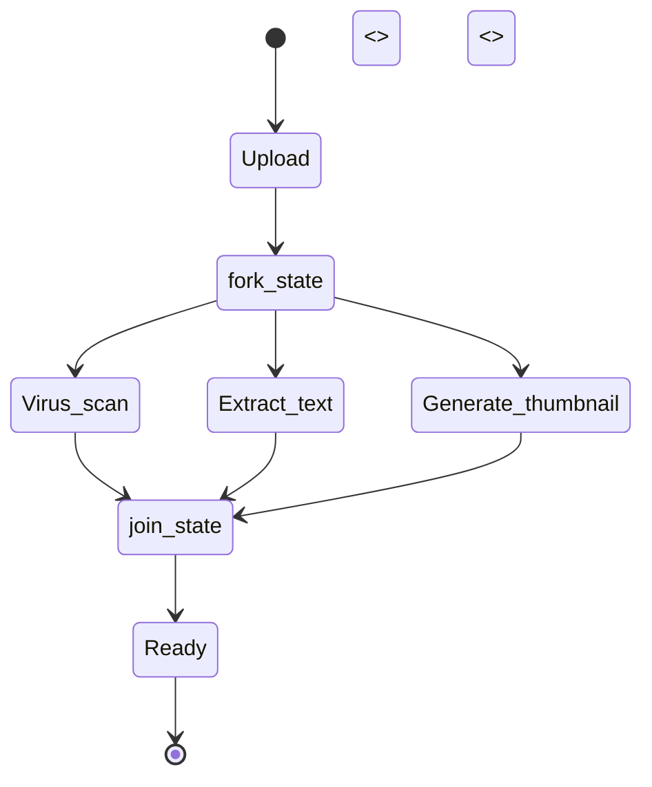

### Example 5: Choice point (validation branching)

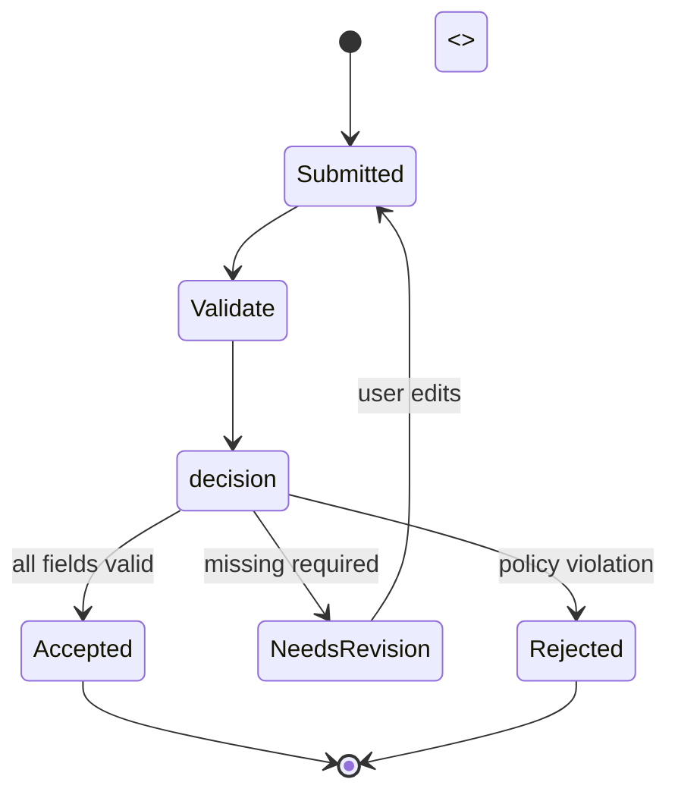

## Error prevention

| ❌ Wrong | ✅ Right | Reason |
|---|---|---|
| `[*] --> A --> B` (chained) | `[*] --> A` then `A --> B` | Chained transitions are a parse error |
| `state1 --> state2 : label` (space around colon) | `state1 --> state2: label` (space after only) | Label syntax is strict |
| `[*]` inside nested state to escape | `[*]` only refers to the **containing scope's** start/end | Nested states have their own start/end |
| Choice without `<<choice>>` marker | `decision <<choice>>` required | Otherwise treated as regular state |
| Unbalanced fork/join | Every `<<fork>>` needs a matching `<<join>>` | Syntax error or orphan branches |
| Missing direction on complex diagram | Add `direction LR` or `direction TB` at top | Default TB may not fit lifecycle widths |

### State diagram vs flowchart — when to pick which

- **State diagram**: discrete states with named transitions triggered by events
- **Flowchart**: steps in a process, often sequential, not necessarily "states"

If your question is "what does the system look like at time T?" → state diagram. If "what happens next in the process?" → flowchart.

See also [obsidian-common-quirks.md](../obsidian-common-quirks.md) for universal rules.
