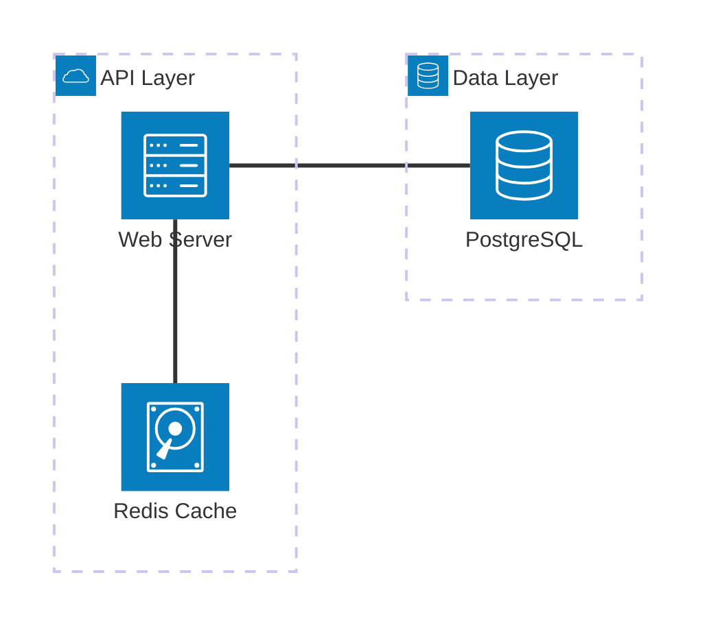
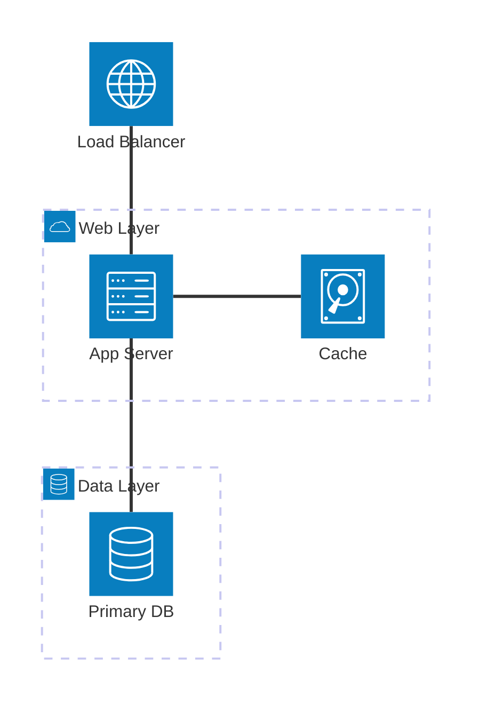
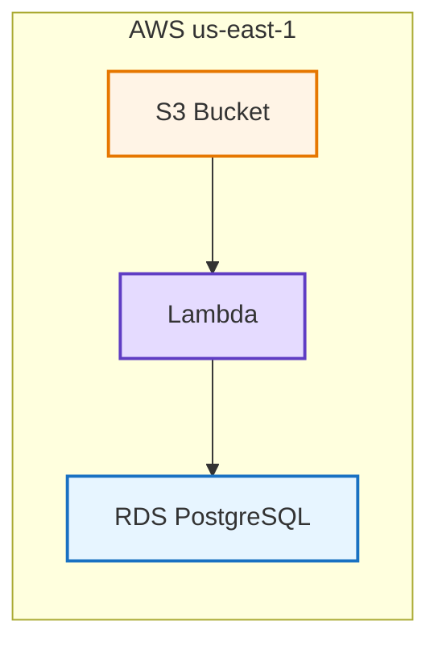

# Architecture Diagram (architecture-beta)

Cloud / infrastructure architecture with service icons — AWS / GCP / Azure / on-prem systems.

## When to use

**Best for**:
- Cloud infrastructure layouts (compute / storage / network / edge)
- Microservice architecture maps
- Deployment topology (load balancer → app servers → database)
- Multi-region or multi-cloud setups
- DevOps / infrastructure as code visualizations

**User query 關鍵字**: architecture / cloud architecture / infrastructure / 工程架構圖 / 架構圖 / cloud diagram / deployment / topology

**Not for**: software component / class structure (use `structural/c4.md`), database schema (use `structural/er.md`), process flow (use `flow/flowchart.md`), generic blocks (use `structural/block.md`).

## Canonical syntax



**Minimum required**:
- `architecture-beta` directive
- At least one `service` (groups optional)
- Connections with `:<edge>` notation

## Configuration options

### Built-in icons

Available without any setup:
- `cloud` — cloud provider / external service
- `database` — DB / storage backend
- `disk` — persistent storage / cache
- `internet` — public network / edge
- `server` — compute / application server

### Icon positioning (edge connection notation)

Each service has 4 connection edges: T (top), B (bottom), L (left), R (right).

```text
serviceA:R -- L:serviceB    # A's right edge → B's left edge
serviceA:B -- T:serviceC    # A's bottom → C's top
serviceA:R -- R:serviceD    # A's right → D's right (siblings)
```

### Groups (logical containers)

```text
group groupId(icon_type)[Display Name]

service svcId(icon)[Display] in groupId
```

Groups provide visual containers (like subgraph in flowchart).

### Iconify icons — do not use in Obsidian

Mermaid.js accepts iconify names such as `service aws_s3(logos:aws-s3)[S3 Bucket]`. Obsidian 1.15 provides no icon resolver, so these icons render as an **empty box** whether online or offline ([engine limits](../obsidian-compatibility.md)). Use the 5 built-in icons, or put the product name in the label.

### Junctions (branching points)

```text
junction id_junction
service a(cloud)[Service A]
service b(cloud)[Service B]

a:R -- L:id_junction
id_junction:R -- L:b
```

Use junctions to branch one output to multiple inputs.

## Obsidian 1.15 compatibility

- **Status**: 🟡 Partial — diagrams render; only the 5 built-in icons draw
- **Known quirks**:
  - Edges must name both sides: `db:R -- L:server` (or `-->`); `db --> server` is a parse error ([quirk 6](../obsidian-common-quirks.md))
  - Iconify / external icons render as an empty box — no icon resolver in Obsidian
  - The header must be `architecture-beta`; plain `architecture` is a parse error
  - Pele lays out groups itself — positions differ from Mermaid.js
- **Fallback**: when the user needs product icons, use `graph TB` + subgraph (Example 3) and name the product in the label

## Quote rule for architecture-beta

architecture-beta uses the bracket form `[Display Label]` for service / group display names. In Obsidian 1.15 (Pele 1.13.0 render check, 2026-11-23) both ASCII and CJK labels render unquoted: `service svc(server)[App Server]`, `service db(database)[資料庫]`. Quoting inside the bracket (`["應用伺服器"]`) also renders clean. If a label contains `[` or `]`, rephrase — those can't be escaped.

If the fallback to `graph TB` is used, apply the standard flowchart quote rule (`A["Label"]`) to the fallback diagram.

## Worked examples

### Example 1: Simple 3-tier web app (built-in icons only, 100% reliable)



### Example 2: Multi-region failover (built-in icons)


### Example 3: Fallback to graph when product icons are needed

Iconify icons (`logos:aws-s3` etc.) render empty in Obsidian, so use `graph TB` + subgraph and name the product in the label:



Lose the icons but keep the architectural clarity.

## Error prevention

| ❌ Wrong | ✅ Right | Reason |
|---|---|---|
| `architecture` (no `-beta`) | `architecture-beta` | Plain `architecture` is a parse error in Pele |
| `service a[Label]` (missing icon) | `service a(server)[Label]` | Renders without an icon — give one for clarity |
| Service referenced before declaration | Declare all services first, then connections | Parser needs forward references |
| `a:R -> L:b` (single arrow) | `a:R -- L:b` (double dash) | Must use `--` between edges |
| `a --> b` (no sides) | `a:R --> L:b` | Edges must name both sides |
| Iconify icon `logos:aws-s3` | Built-in icon + product name in label | External icons render as an empty box |

### Pre-save validation

- [ ] `architecture-beta` declared on line 1
- [ ] All services declared with `service id(icon)[label]` format, built-in icons only
- [ ] Groups use `group id(icon)[label]` format
- [ ] Connections use `:<edge> -- <edge>:` notation

See also [obsidian-common-quirks.md](../obsidian-common-quirks.md) and [obsidian-compatibility.md](../obsidian-compatibility.md).
