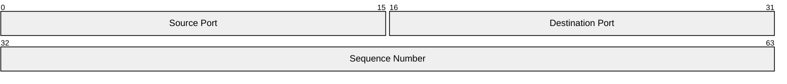
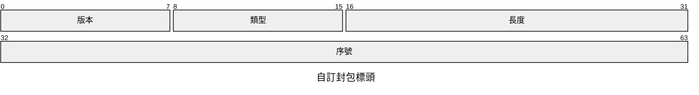

# Packet Diagram (packet-beta)

Bit-level layout of a packet, header or binary record.

## When to use

**Best for**:
- Network protocol headers (TCP / UDP / custom)
- Binary file or register layouts

**User query 關鍵字**: packet / header layout / bit field / protocol format / 封包結構 / 位元欄位 / パケット図

**Not for**: data tables (use a markdown table), database schemas (use `structural/er.md`).

## Canonical syntax

- `start-end: "Label"` gives an inclusive bit range; `+N: "Label"` takes the next N bits.
- Labels are quoted and may be CJK. Optional `title` line.
- `packet` (without `-beta`) also renders.

## Obsidian 1.15 compatibility

- **Status**: ✅ renders in Pele 1.13.0 (validator-checked, not checked on device)
- **Known quirks**: ranges should be contiguous; gaps are not filled for you

## Worked examples

### Example 1: Custom header with relative widths

## Error prevention

| ❌ Wrong | ✅ Right | Reason |
|---|---|---|
| `0-15: Source Port` | `0-15: "Source Port"` | Labels are quoted |
| Overlapping ranges | Contiguous, non-overlapping | Each bit belongs to one field |

See also [obsidian-common-quirks.md](../obsidian-common-quirks.md) for universal rules.
