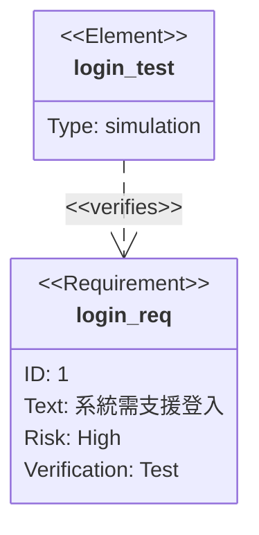
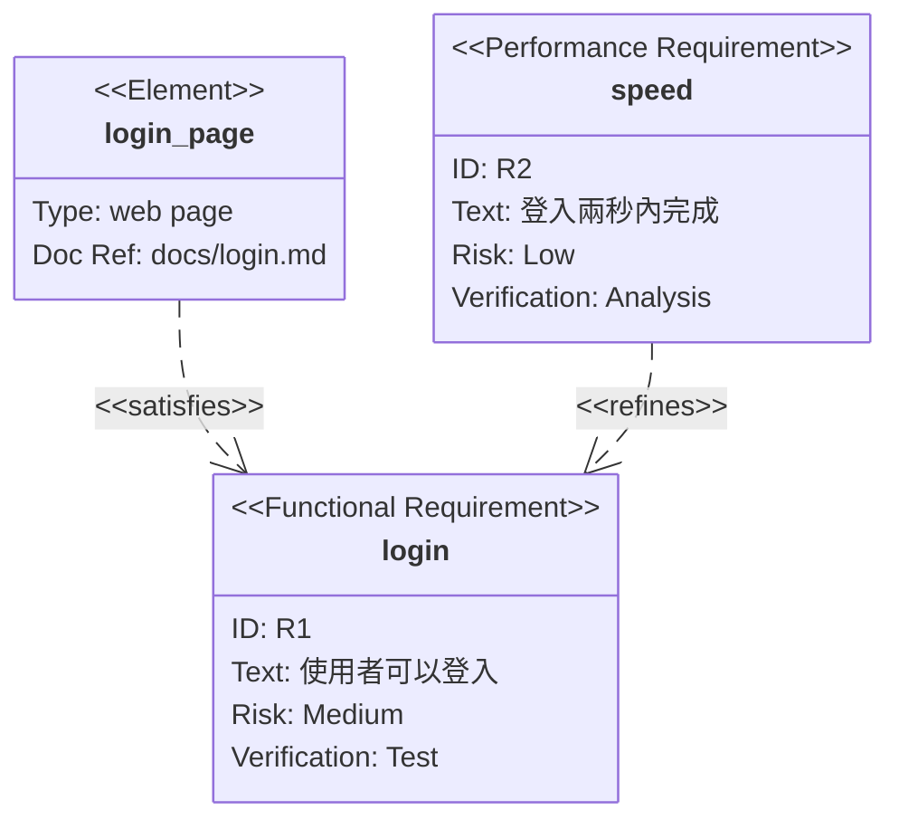

# Requirement Diagram (requirementDiagram)

Requirements, the elements that satisfy or verify them, and how requirements relate — SysML-style traceability.

## When to use

**Best for**:
- Tracing requirements to the components or tests that satisfy / verify them
- Showing refinement and derivation between requirements

**User query 關鍵字**: requirement / traceability / SysML / 需求追溯 / 需求圖 / 要求図

**Not for**: user-facing scope (use `flow/usecase.md`), task status (use `flow/kanban.md`).

## Canonical syntax

- Requirement kinds: `requirement`, `functionalRequirement`, `performanceRequirement`, `interfaceRequirement`, `physicalRequirement`, `designConstraint`.
- Fields: `id`, `text`, `risk` (`low` / `medium` / `high`), `verifymethod` (`analysis` / `inspection` / `test` / `demonstration`).
- Element fields: `type`, `docref`.
- Relations: `A - satisfies -> B`, also `contains`, `copies`, `derives`, `verifies`, `refines`, `traces`.

## Obsidian 1.15 compatibility

- **Status**: ✅ renders in Pele 1.13.0 (validator-checked, not checked on device)
- **Known quirks**: unquoted CJK in `text:` is a lexical error — quote it (`text: "系統需支援登入"`); requirement / element names stay ASCII

## Worked examples

### Example 1: Login requirements

## Error prevention

| ❌ Wrong | ✅ Right | Reason |
|---|---|---|
| `text: 系統需支援登入` | `text: "系統需支援登入"` | Unquoted CJK text fails to lex |
| `A -> satisfies -> B` | `A - satisfies -> B` | Relation syntax is `- kind ->` |

See also [obsidian-common-quirks.md](../obsidian-common-quirks.md) for universal rules.
