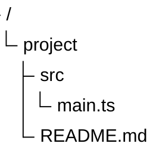
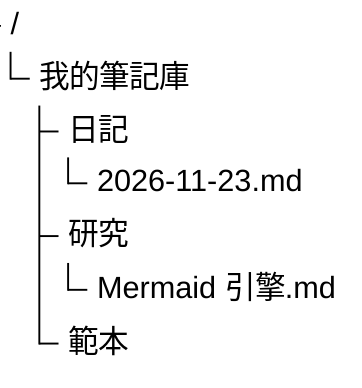

# Tree View (treeView-beta)

A file-explorer style tree — folder layouts, outline hierarchies.

## When to use

**Best for**:
- Directory / repository layouts
- Simple outlines where only nesting matters

**User query 關鍵字**: file tree / folder structure / directory layout / 目錄結構 / 資料夾樹 / ツリー表示

**Not for**: concept maps (use `flow/mindmap.md`), sized hierarchies (use `data-viz/treemap.md`), class inheritance (use `structural/class.md`).

## Canonical syntax

- Keyword is case-sensitive: `treeView-beta`.
- Each entry is a quoted name; indentation sets the nesting.

## Obsidian 1.15 compatibility

- **Status**: ✅ renders in Pele 1.13.0 (validator-checked, not checked on device)
- **Known quirks**: a trailing `/` in a name is not shown; folders and files are told apart only by having children

## Worked examples

### Example 1: Vault layout

## Error prevention

| ❌ Wrong | ✅ Right | Reason |
|---|---|---|
| `treeview-beta` | `treeView-beta` | Keyword is case-sensitive |
| Unquoted names with spaces | `"Mermaid 引擎.md"` | Names are strings |

See also [obsidian-common-quirks.md](../obsidian-common-quirks.md) for universal rules.
